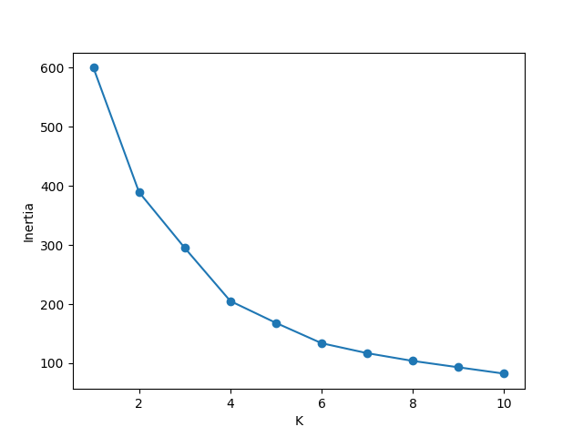
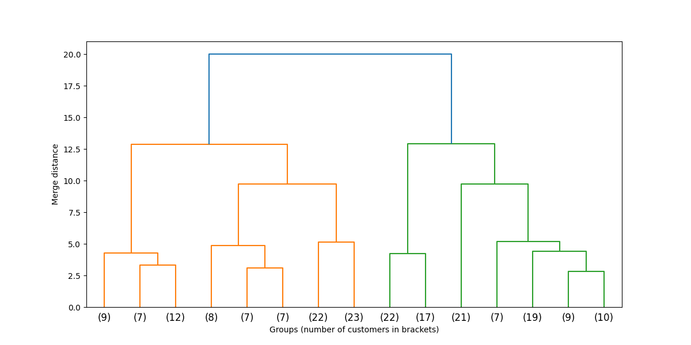
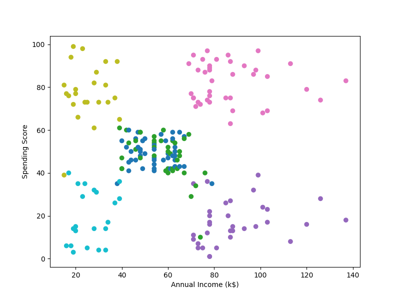

# Customer Segmentation (K-means + FastAPI)

I grouped 200 mall customers into segments using only their age, income and spending score. There are no labels in this data, so the task is unsupervised: I never told the model what a "good customer" looks like, it had to find the groups on its own.

I picked K-means with 6 clusters and checked the result against hierarchical clustering. The two methods put 191 of the 200 customers in matching groups. I then wrapped the trained model in a FastAPI endpoint: send a customer's age, income and spending score, and it returns their segment number and a readable name.

The full exploration is in [`notebooks/exploration.ipynb`](notebooks/customer_segmentation_project.ipynb).

## Quick start

Run everything from the project's top folder. `config.py` lives there, and Python can only import it when you launch from that folder.

```
pip install -r requirements.txt
```

1. Train the model. This creates `models/scaler.pkl` and `models/kmeans_model.pkl`, which the API needs, so it must run first. Run it again only if you change the data or the model. It also prints the average values of each segment, so you can check the segment names.

```
python train.py
```

2. Start the API.

```
uvicorn app.main:app --reload
```

3. Open `http://127.0.0.1:8000/docs` to try the endpoint in your browser.

After retraining, restart the server so it loads the new files.

## API

### `POST /predict`

Request:

```json
{
  "age": 26,
  "income": 34,
  "spending_score": 89
}
```

Response:

```json
{
  "segment": 4,
  "segment_name": "mid 20s, low income, high spender"
}
```

### Input limits

| Field | Allowed range |
|---|---|
| age | 18 to 80 (whole number) |
| income | 15 to 137 (in thousands) |
| spending_score | 1 to 100 (whole number) |

A value outside these ranges, or the wrong type, returns a `422` error that says which field failed.

## The 6 segments

Averages from the original (unscaled) data:

| Segment | Customers | Avg age | Avg income (k$) | Avg spending score | Name |
|---|---|---|---|---|---|
| 0 | 45 | 56.3 | 54.3 | 49.1 | mid 50s, middle income, middle spender |
| 1 | 39 | 26.8 | 57.1 | 48.1 | mid 20s, middle income, middle spender |
| 2 | 33 | 41.9 | 88.9 | 17.0 | late 30s to early 40s, high income, low spender |
| 3 | 39 | 32.7 | 86.5 | 82.1 | late 20s to early 30s, high income, high spender |
| 4 | 23 | 25.0 | 25.3 | 77.6 | mid 20s, low income, high spender |
| 5 | 21 | 45.5 | 26.3 | 19.4 | middle 40s, low income, low spender |

Segments 2 and 3 earn about the same and behave in opposite ways. A mall would probably want to treat them differently, for example by targeting segment 2 with promotions to get them spending.

## Data

[Mall Customer Segmentation Data](https://www.kaggle.com/datasets/vjchoudhary7/customer-segmentation-tutorial-in-python) from Kaggle. 200 customers, with `CustomerID`, `Gender`, `Age`, `Annual Income (k$)` and `Spending Score (1-100)`.

There were no missing values and no duplicate rows. I dropped `CustomerID` (it's just a counter) and encoded `Gender` as 0/1. I left Gender out of the clustering itself and used Age, Annual Income and Spending Score. I didn't test whether adding it changes the groups.

## Approach

1. **Scale the features** with `StandardScaler`. K-means works on distances, so without scaling the feature with the biggest numbers would dominate.
2. **Check PCA.** The cumulative explained variance was 44%, 78% and 100% for PC1, PC2 and PC3. The variance is spread fairly evenly, so PCA couldn't shrink 3 features without losing real information (dropping PC3 would lose about 22%). I clustered on the scaled features directly. PC1 is mostly an age-versus-spending axis, and PC2 is almost entirely income.
3. **Choose K** with the elbow method and the silhouette score.
4. **Run K-means** and profile each cluster using the average age, income and spending score.
5. **Cross-check with hierarchical clustering** (Ward linkage) and compare the two sets of groups.

## Why 6 clusters

I started with K = 4. The inertia curve bends around there: going from K = 3 to 4 dropped inertia by about 90, while 4 to 5 dropped it by only about 37. But the bend is gentle, so the elbow alone couldn't settle it.

The silhouette score was highest at K = 6 (0.428), with K = 4 at 0.404. That is a small gap, and every K from 4 to 8 scored within about 0.02 of each other, so the score alone doesn't prove much. K = 2 and K = 3 were clearly worse (0.335 and 0.358).

The dendrogram gave a third opinion. Cutting the tree at a merge distance of 8 gives 6 groups.

What decided it for me was comparing the actual groups. At K = 4, one cluster averaged 25 years old and 40k income, but it was mixing two kinds of customers. K = 6 splits that cluster into:

- young customers with low income (about 25k) who spend a lot
- slightly older customers with middle income (about 57k) who spend an average amount

Those are different customers, and K = 4 hid the difference. K = 6 also pulled out a low-income, low-spending group that K = 4 had folded into an older cluster.

## Cross-check with hierarchical clustering

I cut the Ward dendrogram into 6 groups and compared them to the K-means clusters with a crosstab. The group sizes were close (K-means: 45, 39, 33, 39, 23, 21; dendrogram: 45, 45, 39, 28, 22, 21), and 191 of 200 customers landed in matching groups. Three clusters matched perfectly. The 9 customers that differ sit on the borders between neighbouring groups, mostly around cluster 2.

Clusters 0 and 1 have almost the same income and spending. Only age separates them (56 vs 27). Both methods still split them cleanly, which suggests the age difference is real and not just K-means cutting one blob in half.

## Plots





## Limitations

- The dataset is small (200 customers) and has only three usable features, so the segments are simple.
- The choice of K is a judgment call. The silhouette scores for K = 4 to 8 are close, and I chose 6 partly because the groups made the most sense when I described them.
- No single 2D plot shows all six clusters cleanly. On the income vs spending plot, clusters 0 and 1 blend together because age, the feature that separates them, isn't on the axes.
- I didn't test whether including Gender changes the clusters.
- The segment names are written by hand from the cluster centers. If you retrain on different data, the cluster numbers can change, so check the printed centers and update `SEGMENT_NAMES` in `app/main.py`.
- The input limits in the API are also hand-set, based on the range of this dataset.

## Project structure

```
Customer_segmentation_project/
├── app/
│   └── main.py          # FastAPI app
├── data/
│   └── Mall_Customers.csv
├── images/              # plots used in this README
├── models/              # saved scaler and model (created by train.py)
├── notebooks/
│   └── exploration.ipynb
├── config.py            # shared feature names and model paths
├── train.py             # trains and saves the scaler and model
├── requirements.txt
└── README.md
```

## Tools

Python, pandas, NumPy, scikit-learn, SciPy, Matplotlib, joblib, FastAPI, Pydantic, Uvicorn.